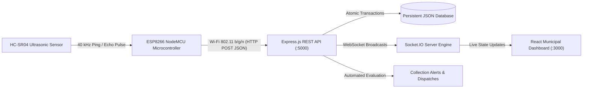
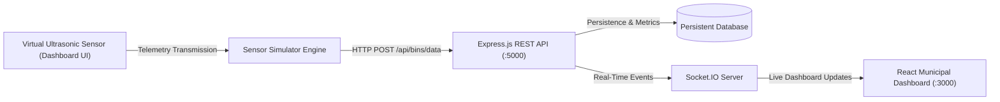

# SmartBin — IoT-Enabled Garbage Bin Monitoring & Municipal Dashboard

[](https://nodejs.org/)
[](https://vitejs.dev/)
[](https://www.espressif.com/)
[](#8-demonstrating-the-8-test-scenarios-a-through-h)
[-success.svg)](./tests)

---

## 1. Problem Statement

> *"Develop an IoT-enabled garbage bin that senses fill level using an ultrasonic sensor and sends bin status to the municipal dashboard using ESP8266."*

Traditional municipal waste collection relies on predetermined routes and fixed schedules. This frequently leads to two major operational inefficiencies:
1. Empty or low-fill bins being serviced unnecessarily, causing wasted fuel and labour.
2. Overflowing public bins going unnoticed between collection shifts, leading to unsanitary urban conditions, pest infestation, and public health hazards.

---

## 2. Abstract

**SmartBin** is an end-to-end, IoT-powered municipal waste management system that measures real-time garbage fill levels using ultrasonic acoustics and transmits telemetry via Wi-Fi from an **ESP8266 NodeMCU** microcontroller to a high-performance **Node.js Express** backend and **React** municipal control center.

The project features a **dual-mode architecture**:
- **Hardware Mode**: Connects physical ESP8266 NodeMCU microcontrollers and HC-SR04 ultrasonic sensors.
- **Simulation Mode**: Includes a dashboard-based software sensor simulator and a Wokwi ESP32 simulation with real-time ultrasonic readings. The production firmware remains targeted at ESP8266 NodeMCU hardware.

---

## 3. System Architecture

### Physical Hardware Architecture


### Software Simulation Architecture


---

## 4. Hardware Requirements & Circuit Wiring

| Component | Specification | Function |
|:---|:---|:---|
| **Microcontroller** | ESP8266 NodeMCU v2 / v3 (ESP-12E) | Microcontroller, 80 MHz, 2.4 GHz Wi-Fi |
| **Distance Sensor** | HC-SR04 Ultrasonic Module | Acoustic distance measurement (2 cm – 400 cm) |
| **Resistor R1** | $1\,\text{k}\Omega$ ($1/4\text{W}$) | Voltage divider upper branch |
| **Resistor R2** | $2\,\text{k}\Omega$ ($1/4\text{W}$) | Voltage divider lower branch |
| **Power Supply** | 5V / 1A USB Micro-B or External 5V | Supplies NodeMCU VIN and HC-SR04 VCC |
| **Breadboard & Wires** | Half-size breadboard + Dupont jumpers | Prototyping interconnects |

### Circuit Wiring Table

| HC-SR04 Pin | Target NodeMCU Connection | Voltage / Logic Level | Notes |
|:---|:---|:---|:---|
| **VCC** | **VIN (or 5V)** | $+5\text{V DC}$ | Requires 5V for transducer ping |
| **GND** | **GND** | $0\text{V}$ | Common Ground |
| **TRIG** | **D5 (GPIO 14)** | $3.3\text{V Logic (Output)}$ | NodeMCU drives $10\,\mu\text{s}$ trigger pulse |
| **ECHO** | Voltage Divider $\to$ **D6 (GPIO 12)** | Stepped down to $\approx 3.3\text{V}$ | **CRITICAL: NEVER connect 5V directly to ESP8266 GPIO!** |

> [!CAUTION]
> **Voltage Divider Protection**: The HC-SR04 Echo output produces a 5V signal, whereas ESP8266 GPIO pins are strictly 3.3V logic. Connecting Echo directly can permanently damage the ESP8266 chip. Connect HC-SR04 Echo to a $1\,\text{k}\Omega$ resistor in series to NodeMCU pin D6, and connect a $2\,\text{k}\Omega$ resistor from D6 to GND.
>
> $$V_{\text{out}} = 5\text{V} \times \frac{2\,\text{k}\Omega}{1\,\text{k}\Omega + 2\,\text{k}\Omega} = 3.33\text{V}$$

---

## 5. Ultrasonic Sensor Working Principle & Mathematical Model

The HC-SR04 ultrasonic sensor operates on acoustic echolocation:
1. The microcontroller applies a $10\,\mu\text{s}$ HIGH pulse to the **TRIG** pin.
2. The transducer transmits eight ultrasonic sound burst pulses at $40\,\text{kHz}$.
3. When the sound waves strike the garbage surface, they reflect back to the receiver transducer.
4. The **ECHO** pin remains HIGH for the round-trip duration $\Delta t$ in microseconds.
5. Sound travels at approximately $343\,\text{m/s}$ ($0.0343\,\text{cm}/\mu\text{s}$ at $20^\circ\text{C}$):

$$\text{Measured Distance (cm)} = \frac{\text{Echo Pulse Width } (\mu\text{s}) \times 0.0343\,\text{cm}/\mu\text{s}}{2} = \frac{\text{Echo Duration}}{58.31}$$

### Garbage Bin Fill Percentage Formula

$$\text{Fill Percentage } (\%) = \left(\frac{\text{Empty Distance} - \text{Measured Distance}}{\text{Empty Distance} - \text{Full Distance}}\right) \times 100$$

- **Default Empty Distance**: $40.0\text{ cm}$ (Distance from sensor down to bottom of an empty bin)
- **Default Full Distance**: $5.0\text{ cm}$ (Sensor clearance when bin is 100% full)
- **Usable Bin Height**: $40.0 - 5.0 = 35.0\text{ cm}$

#### Example Calculation:
If measured distance is $22.5\text{ cm}$:

$$\text{Fill } \% = \left(\frac{40.0 - 22.5}{40.0 - 5.0}\right) \times 100 = \left(\frac{17.5}{35.0}\right) \times 100 = 50.0\%$$

### Municipal Status Classification Rules

| Fill Level (%) | Measured Distance | Status Classification | UI Color Code | Municipal Action |
|:---|:---|:---|:---|:---|
| **0% – 49%** | $\ge 22.8\text{ cm}$ | **LOW / SAFE** | Green (`#16A34A`) | Healthy. Normal monitoring. |
| **50% – 79%** | $12.3\text{ cm} - 22.7\text{ cm}$ | **MEDIUM** | Peacock Blue (`#087E8B`) | Normal capacity. |
| **80% – 94%** | $7.1\text{ cm} - 12.2\text{ cm}$ | **HIGH / COLLECTION NEEDED** | Amber (`#D97706`) | Schedule garbage truck collection. |
| **95% – 100%** | $\le 7.0\text{ cm}$ | **FULL / URGENT DISPATCH** | Crimson Red (`#DC2626`) | Emergency dispatch to prevent overflow. |
| **Invalid / Timeout** | $\le 0\text{ cm}$ or $> 50\text{ cm}$ | **SENSOR ERROR** | Purple (`#9333EA`) | Inspect HC-SR04 transducer & wiring. |
| **Device Stale** | No ping $> 60\text{s}$ | **OFFLINE / STALE DATA** | Gray (`#64748B`) | Check ESP8266 power and Wi-Fi signal. |

---

## 6. Software Stack

- **Frontend**:
  - React 18 with Vite
  - Lucide React Icons
  - Recharts (Line charts, Bar charts, Donut charts)
  - Axios for REST communication
  - Socket.IO Client for real-time live push updates
  - Pure Standard CSS with custom CSS variables (Zero Tailwind)
- **Backend**:
  - Node.js (v18+) & Express.js
  - Socket.IO WebSockets Server
  - Atomic Persistent Local Database (`backend/data/smartbin.json`)
  - Background Stale Device Monitoring Daemon
  - Intelligent Alert Deduplication & Auto-Resolution Engine
- **Firmware**:
  - Arduino C++ for ESP8266 NodeMCU
  - Median acoustic sample noise filter (rejects acoustic reflections)
  - Non-blocking telemetry scheduling
  - Automatic Wi-Fi reconnection handling
- **Simulation**:
  - **CLI Simulator**: `simulation/sensorSimulator.js` with scenarios A through H
  - **Wokwi simulation**: `diagram.json` uses a supported ESP32 board and simulation-only firmware; build it with `npm run wokwi:build`

---

## 7. Windows PowerShell Quick Start Commands

### Prerequisites
Make sure **Node.js (v18 or v22)** is installed on your Windows machine:
```powershell
node -v
npm -v
```

### Installation
Clone or navigate to the project directory in Windows PowerShell:
```powershell
cd "d:\Dev\Projects\IOT Project"
```

Install backend, frontend, and root dependencies:
```powershell
npm run install:all
```

---

### Running the Application

You can start the entire stack with a single command from the project root:
```powershell
npm run dev
```

Alternatively, run backend and frontend in separate PowerShell terminals:

#### Terminal 1 — Start Backend Server:
```powershell
cd "d:\Dev\Projects\IOT Project\backend"
npm run dev
```
*Output: Backend running on `http://localhost:5000` with Socket.IO initialized.*

#### Terminal 2 — Start Frontend Dashboard:
```powershell
cd "d:\Dev\Projects\IOT Project\frontend"
npm run dev
```
*Output: Frontend running on `http://localhost:3000/`.*

Open your web browser and visit: **`http://localhost:3000`**.

---

### Running Automated Test Suites

SmartBin includes 22 automated tests covering formulas, boundary clamping, thresholds, REST APIs, alert deduplication, and stale offline detection:

```powershell
npm test
```

Expected output:
```
TAP version 13
# Subtest: Alert Management & Deduplication Suite
    ok 1 - Creates critical alert when bin becomes FULL and deduplicates on repeat
    ok 2 - Auto-resolves capacity alerts when bin is collected (fill drops to LOW)
    ok 3 - Creates DEVICE_OFFLINE alert when device disconnects
ok 1 - Alert Management & Deduplication Suite
# Subtest: API Integration Suite
    ok 1 - GET /api/health returns status UP and database metrics
    ok 2 - GET /api/bins returns registered bins array
    ok 3 - POST /api/bins/data ingests valid sensor reading
    ok 4 - POST /api/bins/data handles invalid sensor measurement gracefully
    ok 5 - POST /api/bins validates empty distance > full distance
    ok 6 - GET /api/alerts returns alerts list
    ok 7 - GET /api/analytics returns aggregated statistics
ok 2 - API Integration Suite
# Subtest: Stale Device Monitor Suite
    ok 1 - Flags bin as OFFLINE when telemetry age exceeds timeout
ok 3 - Stale Device Monitor Suite
# Subtest: Fill Percentage Formula — Standard Scenarios
ok 4 - Fill Percentage Formula — Standard Scenarios
# Subtest: Fill Percentage Formula — Clamping Behavior
ok 5 - Fill Percentage Formula — Clamping Behavior
# Subtest: Fill Percentage Formula — Invalid Distance Rejection
ok 6 - Fill Percentage Formula — Invalid Distance Rejection
# Subtest: Fill Percentage Formula — Invalid Reference Distances
ok 7 - Fill Percentage Formula — Invalid Reference Distances
# Subtest: Threshold Classification Rules
ok 8 - Threshold Classification Rules
# Subtest: Fault & Offline Status Classification
ok 9 - Fault & Offline Status Classification
# Subtest: Priority Ranking Order
ok 10 - Priority Ranking Order
# Subtest: Recommended Municipal Action Text
ok 11 - Recommended Municipal Action Text
# tests 22
# pass 22
# fail 0
```

---

## 8. Demonstrating the 8 Test Scenarios (A through H)

You can demonstrate all verification scenarios using the **UI Sensor Simulation page** or from the **PowerShell CLI**:

### In the Web Dashboard:
1. Navigate to **Sensor Simulation** in the sidebar.
2. Select any bin (e.g. `BIN-001`).
3. Click the test buttons:
   - **Scenario A**: Sets distance to 40 cm $\to$ **0% Fill (LOW)**
   - **Scenario B**: Sets distance to 22.5 cm $\to$ **50% Fill (MEDIUM)**
   - **Scenario C**: Sets distance to 8.5 cm $\to$ **90% Fill (HIGH)**
   - **Scenario D**: Sets distance to 5.0 cm $\to$ **100% Fill (FULL / Urgent)**
   - **Scenario E**: Injects sensor timeout $\to$ **SENSOR ERROR**
   - **Scenario F**: Disconnects node $\to$ **OFFLINE**
   - **Scenario G**: Simulates backend drop

### From Windows PowerShell CLI:

- **Scenario A (Empty Bin — 40 cm, 0% fill)**:
  ```powershell
  node simulation/sensorSimulator.js --scenario A --bin BIN-001 --once
  ```

- **Scenario B (Half-Filled — 22.5 cm, 50% fill)**:
  ```powershell
  node simulation/sensorSimulator.js --scenario B --bin BIN-001 --once
  ```

- **Scenario C (Nearly Full — 8.5 cm, 90% fill)**:
  ```powershell
  node simulation/sensorSimulator.js --scenario C --bin BIN-001 --once
  ```

- **Scenario D (Completely Full — 5.0 cm, 100% fill)**:
  ```powershell
  node simulation/sensorSimulator.js --scenario D --bin BIN-001 --once
  ```

- **Scenario E (Sensor Fault / Timeout)**:
  ```powershell
  node simulation/sensorSimulator.js --scenario E --bin BIN-001 --once
  ```

- **Scenario F (Wi-Fi Disconnection / Packet Drop)**:
  ```powershell
  node simulation/sensorSimulator.js --scenario F --bin BIN-001
  ```

- **Scenario H (Multi-Bin Autonomous City Simulation)**:
  ```powershell
  node simulation/sensorSimulator.js --scenario H --interval 3
  ```

---

## 9. Connecting Physical ESP8266 Hardware

1. Open `firmware/config.example.h` and copy it to `firmware/config.h`:
   ```powershell
   Copy-Item firmware/config.example.h firmware/config.h
   ```
2. In `firmware/config.h`, set your 2.4 GHz Wi-Fi credentials:
   ```cpp
   #define WIFI_SSID       "YourWiFiNetwork"
   #define WIFI_PASSWORD   "YourWiFiPassword"
   ```
3. Set your computer's local LAN IPv4 address:
   ```powershell
   ipconfig
   # Look for IPv4 Address (e.g., 192.168.1.100)
   ```
   Update `firmware/config.h`:
   ```cpp
   #define BACKEND_API_URL "http://192.168.1.100:5000/api/bins/data"
   ```
4. Wire the hardware according to the Circuit Wiring Table (with voltage divider on pin D6).
5. Open `firmware/garbage_bin.ino` in Arduino IDE:
   - Select Board: **NodeMCU 1.0 (ESP-12E Module)**.
   - Select Port: (COM3, COM4, etc.).
   - Upload sketch at 115200 baud.
6. Open Serial Monitor at 115200 baud. The node will connect to Wi-Fi, take median-filtered readings, and transmit telemetry to your municipal dashboard in real time!

---

## 10. Wokwi Simulation

Wokwi does not currently support the production ESP8266/NodeMCU firmware, so the Wokwi diagram uses a supported ESP32 DevKit V1 with simulation-only firmware. The production firmware and physical wiring remain ESP8266-targeted.

1. Install the ESP32 Arduino core for Arduino CLI if it is not installed:
   ```powershell
   arduino-cli core install esp32:esp32
   ```
2. Build the Wokwi firmware:
   ```powershell
   npm run wokwi:build
   ```
3. Open the project in Wokwi and start the simulation. The ultrasonic sensor echo is level-shifted through the two resistors before reaching GPIO 27.
4. To test without Wokwi or physical hardware, use the [CLI sensor simulator](#8-demonstrating-the-8-test-scenarios-a-through-h). To run the production ESP8266 firmware, follow [Connecting Physical ESP8266 Hardware](#9-connecting-physical-esp8266-hardware).

---

## 11. REST API Specification

### 1. Ingest IoT Telemetry
- **Endpoint**: `POST /api/bins/data`
- **Payload**:
  ```json
  {
    "bin_id": "BIN-001",
    "distance_cm": 22.5,
    "sensor_valid": true,
    "source": "hardware"
  }
  ```
- **Response** (`200 OK`):
  ```json
  {
    "success": true,
    "message": "Reading processed successfully.",
    "data": {
      "bin": {
        "id": "BIN-001",
        "distance_cm": 22.5,
        "fill_percentage": 50.0,
        "status": "MEDIUM",
        "action": "NORMAL MONITORING: Capacity optimal. Projected collection in 24-48 hours.",
        "priority": 5
      }
    }
  }
  ```

### 2. List All Bins
- **Endpoint**: `GET /api/bins`
- **Response**: Array of all registered bins with latest fill percentage and status.

### 3. Get Bin Details & History
- **Endpoint**: `GET /api/bins/:id`
- **Response**: Bin metadata, last 50 historical telemetry readings, and active alerts.

### 4. Register New Bin
- **Endpoint**: `POST /api/bins`
- **Payload**:
  ```json
  {
    "id": "BIN-007",
    "name": "East Gate Receptacle",
    "location": "Sports Arena",
    "empty_distance": 40.0,
    "full_distance": 5.0,
    "collection_threshold": 80,
    "urgent_threshold": 95
  }
  ```

### 5. Collection Alerts
- **Endpoint**: `GET /api/alerts?includeResolved=false`
- **Resolve Alert**: `PATCH /api/alerts/:id/resolve`

### 6. Analytics Aggregations
- **Endpoint**: `GET /api/analytics`
- **Response**: Fleet counts, average fill %, status breakdown, location distributions, and priority rankings.

### 7. Simulation Control
- **Endpoint**: `POST /api/simulation/control`
- **Payloads**:
  - `{"action": "scenario", "scenario": "nearly_full", "bin_id": "BIN-001"}`
  - `{"action": "set_distance", "bin_id": "BIN-001", "distance": 8.5}`
  - `{"action": "pause"}` / `{"action": "resume"}` / `{"action": "reset"}`

---

## 12. Limitations & Future Enhancements

### Current Limitations
1. **Acoustic Conical Spread**: Ultrasonic sensors have a $15^\circ$ beam spread. In very narrow bins, acoustic waves may reflect off the bin sidewalls rather than the garbage surface.
2. **Irregular Trash Topography**: Garbage piles can be uneven; a single-point measurement reflects the highest point within the acoustic cone.
3. **Power Budget**: Real-world field deployment requires LiPo battery power with ESP8266 Deep Sleep ($15\,\mu\text{A}$) waking every 15–30 minutes rather than continuous polling.

### Future Enhancements
1. **Multi-Point LiDAR / ToF Sensors**: Implement VL53L1X time-of-flight laser sensors for millimeter precision and narrow beam angle.
2. **Dynamic Route Optimization**: Integrate Dijkstra or Travelling Salesperson Problem (TSP) algorithms with OpenStreetMap to compute optimal garbage truck itineraries based on bins flagged for collection.
3. **Solar Harvesting & Deep Sleep**: Incorporate solar recharging and ESP8266 deep sleep power cycling for multi-year off-grid field deployments.
